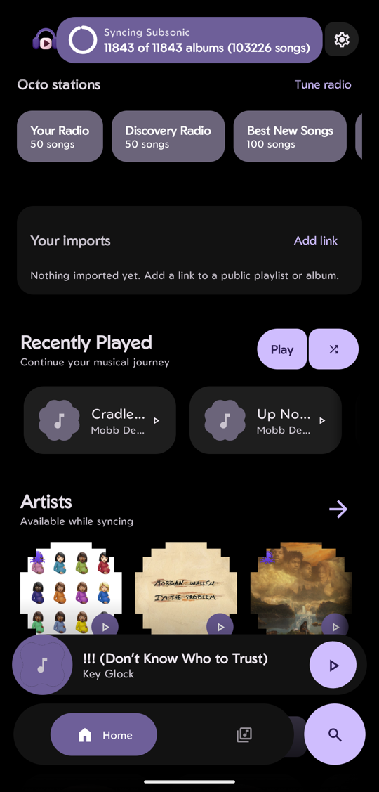
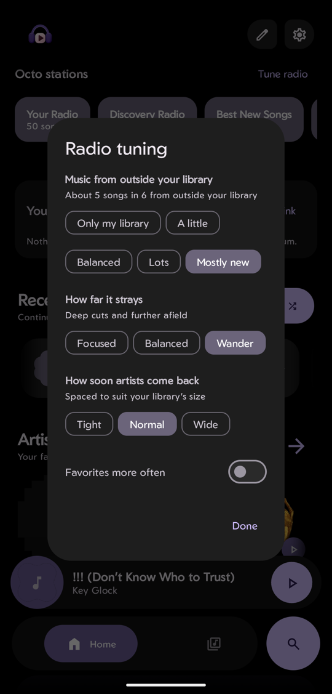
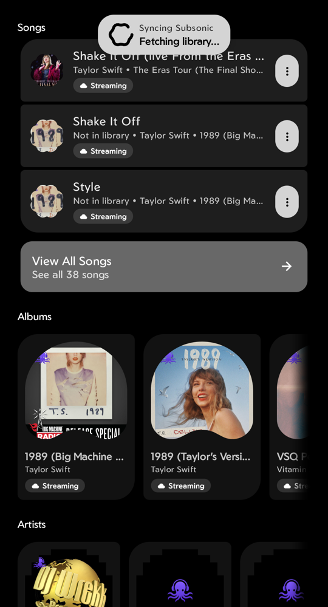

# rhythm-octo-extension

Octo support for [Rhythm](https://github.com/cromaguy/Rhythm), the Android music player, as the
[Octo](https://github.com/winters27/octo) server exposes it. Octo is a Subsonic-compatible proxy that adds YouTube
previews, Last.fm radio, and Soulseek/Lidarr downloads on top of a Navidrome library; Octo's own apps live in
[winters27/octo-player](https://github.com/winters27/octo-player).

**Status: app code, not yet a plugin.** Rhythm has no source-hook extension API, so today this repo holds the code
as new files plus the patches that hook it into Rhythm. It will become a real extension if Rhythm grows the API.
Not affiliated with Rhythm or Octo.

| Home: stations and imports | Radio tuning | Search labels |
|---|---|---|
|  |  |  |

## Features

- **Previews are recognised.** Songs Octo only previews (not yet in your library) are detected, kept out of
  downloads and server playlists, and labelled **Not in library** in search.
- **Hearting a preview is a request to get it.** Octo fetches the song; when it lands in the library, the real song is
  hearted for you.
- **Octo's radios and charts as a rotating offline cache.** Your Radio, Discovery Radio, artist radios and Octo-made
  charts and mixes are downloaded for offline use and released when Octo replaces them. Liked Songs and your own
  playlists are never touched.
- **Stations on Home**, one tap to play, plus **Start radio** on any song.
- **Radio mixed the way Octo's apps do it**, with the four tuning dials (music from outside your library, how far it
  strays, how soon artists come back, favorites more often). The mixer is a port of octo-player's `RadioMix`, and its own
  test suite passes unchanged against the port.
- **Requests card**: what Octo is fetching for you right now, with progress.
- **Imports card**: the lists you brought to Octo (Spotify, links, files) with how much of each your library has, a
  switch to fetch what is missing, and **Add link**.
- **Find another copy**: search Soulseek/Lidarr again for a song and choose which copy Octo keeps (needs "Library
  actions" enabled on the Octo server).
- **Offline scrobble queue**: plays made without a connection are sent later with the time they were played.
- **Cover placeholder guard**: a server's "no cover yet" picture is never cached as a song's artwork.

Every feature appears only when the server says it supports it (OpenSubsonic extensions `octoAcquisitions`,
`octoImports`, ...), so a plain Navidrome sees nothing change.

## What is here

- `src/` the new files, at their paths in the Rhythm app, with their unit tests.
- `patches/` the commits (`git format-patch`, in order) that hook those files into Rhythm: the `isExternal` flag, the
  preview signature, the radio-playlist cache, the Home cards, the menu items. Apply them, in order, to a Rhythm checkout
  with `git am patches/*.patch`.
- `docs/` the [roadmap](docs/ROADMAP.md) and screenshots.

Tested against Octo `2026.10.28` and Rhythm's `main` of early November 2026, on a Pixel with GrapheneOS.

## Licence and credits

GPL-3.0-or-later (see `LICENSE`), the same as Rhythm and octo-player. The radio mixer (`radio/RadioMix.kt`,
`RadioFilter.kt`, `RadioTuning.kt`) is ported from [winters27/octo-player](https://github.com/winters27/octo-player);
the wire shapes of Octo's extra calls follow it too.
